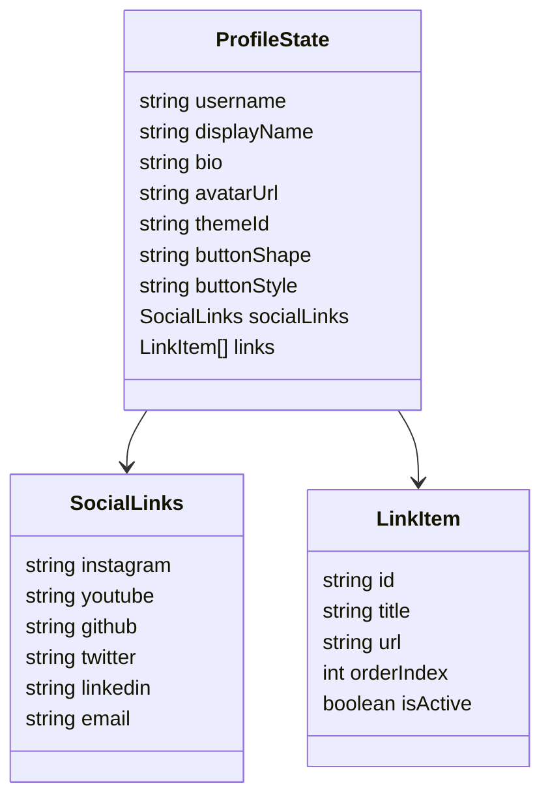

# [PRD] 마이링크 (MyLink) — 모바일 최적화 링크인바이오(Link-in-Bio) 서비스

---

## 1. 프로젝트 개요 (Overview)

### 1.1 서비스 정의
**마이링크(MyLink)**는 사용자의 다양한 온라인 채널(SNS, 포트폴리오, 블로그, 스토어 등)을 단 하나의 모바일 최적화 페이지로 통합하여 보여주는 **링크인바이오(Link-in-Bio) 서비스**입니다.

### 1.2 단계별 개발 전략 (Staged Development Strategy)
프로젝트는 복잡한 인프라 세팅에 앞서 핵심 사용자 경험(UX)을 먼저 검증하기 위해 **단계별(Phased) 점진적 구축 방식**을 채택합니다.
- **1단계 (Phase 1, 현 개발 범위)**: 백엔드 DB나 복잡한 대시보드, 통계 기능 없이 **브라우저 로컬 스토리지(`localStorage`)**와 **Zustand**를 활용한 독립적인 모바일 최적화 **프로필 페이지** 우선 구현.
- **2단계 (Phase 2)**: 전용 분할형 관리자 대시보드 UI 및 링크 클릭/방문자 통계(Analytics) 기능 추가.
- **3단계 (Phase 3)**: Supabase(PostgreSQL/Auth) 백엔드 연동을 통한 멀티테넌트 SaaS화 및 `/[username]` 고유 주소 체계 확립.
- **4단계 (Phase 4)**: 커스텀 도메인, 고급 마케팅 분석 등 Pro 기능 확장.

---

## 2. 사용자 및 유즈케이스 (Target Users & Use Cases)

### 2.1 대상 페르소나 및 핵심 가치
| 대상 페르소나 | 주요 니즈 | 마이링크의 핵심 가치 |
|---|---|---|
| **SNS 크리에이터/인플루언서** | 인스타/유튜브 프로필에 여러 채널 링크를 모바일 최적화 형태로 제공 | 별도 가입/복잡한 세팅 없이 즉시 링크 구성 및 모바일 뷰 확인 |
| **개발자 / 디자이너 / 구직자** | GitHub, 포트폴리오, 블로그, 이력서를 하나의 세련된 링크로 집약 | 감각적인 테마와 빠른 로딩, 깔끔한 카드 레이아웃 |
| **소상공인 / 스마트스토어 판매자** | 카카오톡 채널, 네이버 스마트스토어, 매장 위치 안내 | 모바일에서 빠른 로딩 속도와 명확한 Call-To-Action(CTA) 버튼 |

### 2.2 사용자 시나리오 (User Scenarios)

본 시나리오는 마이링크의 두 핵심 주체인 **방문자(Visitor)**와 **소유자(Owner)** 관점에서 단계별로 구체화한 행동 흐름이며, 모든 행동은 `"사용자는 ___하기 위해 ___한다"` 형식으로 기술합니다.

#### 1. 방문자(Visitor) 시나리오: 다른 사람의 마이링크 페이지를 방문하고 탐색하는 과정
- **목적**: 인스타그램 등 외부 SNS에서 프로필 링크를 통해 유입되어 운영자의 최신 소식 및 목적지 링크로 이동

1. **페이지 진입 단계**:
   - 사용자는 관심 있는 크리에이터의 추가 채널과 링크 목록을 확인하기 위해 **SNS 프로필 바이오에 기재된 마이링크 주소(`mylink.io/[username]`)를 터치한다**.
   - 사용자는 지연 없는 최적화된 모바일 화면을 경험하기 위해 **모바일 인앱 브라우저를 통해 마이링크 프로필 화면으로 접속한다**.
2. **프로필 탐색 단계**:
   - 사용자는 페이지의 주인이 누구인지 식별하기 위해 **상단에 배치된 프로필 사진(아바타), 표시 이름, 한 줄 소개(Bio) 문구를 확인한다**.
   - 사용자는 크리에이터의 다른 소셜 미디어로 이동하기 위해 **프로필 바로 아래 위치한 소셜 아이콘 바(인스타그램, 유튜브, 깃허브 등)를 탐색한다**.
3. **링크 선택 및 이동 단계**:
   - 사용자는 자신이 찾고자 하는 콘텐츠나 구매하고자 하는 상품을 탐색하기 위해 **중앙의 링크 버튼 목록(제목 및 부가 정보)을 위아래로 스크롤하며 확인한다**.
   - 사용자는 해당 웹페이지나 서비스로 이동하기 위해 **원하는 링크 카드 버튼을 직접 클릭/터치하여 새 브라우저 창으로 이동한다**.
4. **프로필 공유 단계 (선택 사항)**:
   - 사용자는 이 프로필 링크를 친구에게 공유하거나 나중에 다시 보기 위해 **화면 상단의 [공유하기] 버튼을 눌러 링크를 클립보드에 복사하거나 메신저로 전달한다**.

---

#### 2. 소유자(Owner) 시나리오: 자신의 마이링크를 관리하는 과정 (Phase 1 로컬 스토리지 기준)
- **목적**: 복잡한 관리자 페이지나 서버 구축 없이 브라우저에서 직접 링크를 추가/수정/삭제하고 나만의 개성을 반영

1. **접속 및 편집 모드 활성화 단계**:
   - 사용자는 자신의 링크 페이지를 업데이트하기 위해 **웹 브라우저를 통해 마이링크 페이지에 접속한다**.
   - 사용자는 링크 및 프로필 수정 권한을 활성화하기 위해 **프로필 상단의 [편집 모드] 토글/버튼을 클릭한다**.
2. **프로필 및 디자인 커스터마이징 단계**:
   - 사용자는 방문자에게 자신을 효과적으로 브랜딩하기 위해 **프로필 이미지 URL을 변경하고, 표시 이름과 한 줄 소개(Bio)를 작성한다**.
   - 사용자는 다양한 SNS 채널을 한곳에 안내하기 위해 **소셜 미디어 입력란에 자신의 인스타그램, 유튜브, 깃허브 등의 URL을 등록한다**.
   - 사용자는 자신만의 시각적 무드를 연출하기 위해 **6가지 프리셋 테마 중 하나를 선택하고 버튼 모양(알약형/라운드/각진형)과 채우기 스타일을 지정한다**.
3. **링크 추가 단계 (Create)**:
   - 사용자는 방문자에게 새롭게 안내할 콘텐츠를 등록하기 위해 **[새 링크 추가] 버튼을 클릭한다**.
   - 사용자는 방문자가 링크의 목적을 쉽게 이해할 수 있도록 **버튼 제목(예: "2026 다이어리 마켓 🛍️")과 목적지 URL(https://...)을 입력하고 [등록] 버튼을 누른다**.
4. **링크 수정 및 순서 변경 단계 (Update & Reorder)**:
   - 사용자는 링크의 설명 문구를 개선하거나 변경된 주소를 갱신하기 위해 **해당 링크 카드의 [수정] 버튼을 눌러 제목과 URL을 업데이트한다**.
   - 사용자는 현재 가장 강조하고 싶은 중요한 링크를 방문자 눈에 띄게 상단에 배치하기 위해 **링크 카드 좌측의 핸들을 드래그하거나 순서 이동 버튼을 눌러 최상단으로 끌어올린다**.
   - 사용자는 이벤트가 종료된 링크를 일시적으로 감추기 위해 **링크 카드의 [노출 토글(ON/OFF)] 스위치를 꺼서 화면에서 숨긴다**.
5. **링크 삭제 단계 (Delete)**:
   - 사용자는 더 이상 사용하지 않는 불필요한 링크를 영구 정리하기 위해 **해당 링크 카드의 [삭제] 버튼을 클릭하고 안내 팝업을 승인한다**.
6. **저장 완료 및 최종 확인 단계 (Persist & Verify)**:
   - 사용자는 지금까지 작업한 모든 변경 사항을 영구 보존하기 위해 **브라우저 로컬 스토리지(`localStorage`)에 자동 저장되는 상태를 확인한다**.
   - 사용자는 방문자가 실제로 보게 될 최종 화면을 점검하기 위해 **[편집 모드]를 종료하고 완성된 모바일 뷰를 검토한다**.

---

## 3. 핵심 기능 요구사항 (Functional Requirements)

### 3.1 [Phase 1: 현재 집중 개발] 로컬 기반 프로필 페이지
Phase 1에서는 서버 및 별도 관리자 페이지 없이, **단일 페이지 내에서 로컬 스토리지를 활용하여 실시간 편집 및 확인이 가능한 완성도 높은 프로필 페이지**를 구현합니다.

1. **프로필 영역 (Profile Header)**:
   - 프로필 아바타 이미지 (URL 입력 또는 프리셋 아바타 선택, 원형 마스크).
   - 표시 이름(Display Name, 최대 30자) 및 한 줄 소개(Bio, 최대 150자).
2. **SNS 소셜 아이콘 바 (Social Icon Bar)**:
   - 주요 SNS 채널 링크 등록 (Instagram, YouTube, X, GitHub, LinkedIn, Threads, Email 등).
   - 클릭 시 해당 플랫폼으로 새 창(`_blank`) 이동.
3. **링크 블록 목록 (Link Blocks)**:
   - 링크 버튼 목록 렌더링 (제목 + URL).
   - 클릭 시 지정된 대상 URL로 새 탭/창 이동.
   - 링크 활성화/비활성화(Show/Hide) 상태 반영.
4. **테마 및 디자인 커스터마이징 (Theme & Appearance)**:
   - **6가지 큐레이션 프리셋 테마 지원**:
     1. *Clean White*: 깔끔한 모던 라이트 테마
     2. *Midnight Dark*: 세련된 고대비 다크 테마
     3. *Cyber Gaming*: 플레이스테이션 감성의 테크니컬 네온 다크
     4. *Pastel Sky*: 부드러운 라벤더 & 스카이 그라디언트
     5. *Warm Peach*: 따스한 코랄/피치 무드
     6. *Neo Brutalism*: 볼드한 테두리와 팝한 색감
   - **버튼 스타일 커스텀**:
     - 형태: 알약형(Pill, `rounded-full`), 라운드형(Rounded, `rounded-2xl`), 각진형(Sharp, `rounded-none`)
     - 채우기: 솔리드(Solid), 아웃라인(Outline), 반투명 글래스(Glassmorphism)
5. **인라인/모달 간편 편집 기능 (Quick Editor)**:
   - 프로필 화면 상단(또는 플로팅 버튼)의 '편집 모드'를 통해 링크 추가/수정/삭제/순서 이동, 프로필 문구, 테마 변경 수행.
   - 수정된 모든 내용은 브라우저 `localStorage`에 자동 영구 저장되어 새로고침 후에도 유지.

---

### 3.2 [Phase 2: 차기 예정] 관리자 대시보드 및 통계 기능
1. **분할형 관리자 대시보드 (`/dashboard`)**:
   - 좌측 편집 패널 + 우측 실시간 모바일 스마트폰 목업(Live Preview) 레이아웃.
   - `@dnd-kit` 기반 드래그 앤 드롭 링크 순서 변경.
2. **방문자 및 클릭 통계 (Analytics)**:
   - 페이지 총 조회수(Page Views) 및 링크별 누적 클릭수(Clicks) 카운트.
   - 클릭률(CTR) 계산 및 요약 지표 제공.

---

### 3.3 [Phase 3: 차기 예정] 멀티테넌트 SaaS & 백엔드 연동
1. **인증 및 계정 체계**:
   - 이메일/비밀번호 회원가입 및 고유 사용자 핸들(`username`) 선점.
   - Supabase Auth 기반 세션 관리.
2. **클라우드 데이터베이스 및 스토리지 연동**:
   - Supabase PostgreSQL 기반 데이터 영속화.
   - Supabase Storage를 통한 프로필 이미지 파일 직접 업로드.
3. **공개 URL 라우팅 및 공유 최적화**:
   - `/[username]` 고유 경로 라우팅.
   - 카카오톡, 인스타그램 등 공유를 위한 동적 OpenGraph 메타태그 생성.

---

## 4. 데이터 스키마 및 상태 모델 (Data & State Model)

Phase 1에서는 브라우저의 `localStorage`에 아래 구조의 JSON 형태로 저장되며, Zustand의 `persist` 미들웨어로 관리됩니다. (향후 DB 테이블과 1:1 매핑 호환)



### 4.1 초기 시드 및 더미 데이터 (Initial Seed & Dummy Data)

Phase 1 초기 렌더링 및 '기본값으로 초기화(Reset)' 시 아래의 기본 링크 더미 데이터를 사용합니다.

#### 기본 링크 목록 더미 데이터 (LinkItem[])
```json
[
  {
    "id": "link-1",
    "profileId": "profile-1",
    "title": "🖥️ 개인 포트폴리오 웹사이트",
    "url": "https://portfolio.example.com",
    "orderIndex": 0,
    "isActive": true,
    "clickCount": 142,
    "createdAt": "2026-03-15T09:00:00.000Z"
  },
  {
    "id": "link-2",
    "profileId": "profile-1",
    "title": "💻 GitHub 프로필 & 프로젝트",
    "url": "https://github.com/example",
    "orderIndex": 1,
    "isActive": true,
    "clickCount": 98,
    "createdAt": "2026-03-15T09:10:00.000Z"
  },
  {
    "id": "link-3",
    "profileId": "profile-1",
    "title": "📝 기술 블로그 (Velog / Devlog)",
    "url": "https://velog.io/@example",
    "orderIndex": 2,
    "isActive": true,
    "clickCount": 65,
    "createdAt": "2026-03-15T09:20:00.000Z"
  },
  {
    "id": "link-4",
    "profileId": "profile-1",
    "title": "📄 프로젝트 포트폴리오 (Notion)",
    "url": "https://notion.so/example-portfolio",
    "orderIndex": 3,
    "isActive": true,
    "clickCount": 47,
    "createdAt": "2026-03-15T09:30:00.000Z"
  },
  {
    "id": "link-5",
    "profileId": "profile-1",
    "title": "📷 일상 & 작업 인스타그램",
    "url": "https://instagram.com/example",
    "orderIndex": 4,
    "isActive": true,
    "clickCount": 31,
    "createdAt": "2026-03-15T09:40:00.000Z"
  },
  {
    "id": "link-6",
    "profileId": "profile-1",
    "title": "💬 1:1 오픈채팅 / 커피챗 문의",
    "url": "https://open.kakao.com/o/example",
    "orderIndex": 5,
    "isActive": false,
    "clickCount": 12,
    "createdAt": "2026-03-15T09:50:00.000Z"
  }
]
```

---

## 5. 시스템 아키텍처 및 기술 스택 (Architecture & Tech Stack)

| 구분 | Phase 1 (현재) | Phase 2 ~ 3 (확장 시) | 선정 사유 |
|---|---|---|---|
| **프레임워크** | Next.js 16 (App Router), React 19, TypeScript | 동일 | 빠른 컴파일(Turbopack)과 모바일 최적화 웹 구조 |
| **전역 상태 관리** | **Zustand (`persist` 미들웨어)** | 동일 (서버 상태 연동) | 보일러플레이트 없는 경량 스토어(<1KB), 로컬스토리지 동기화 용이 |
| **데이터 저장소** | **브라우저 `localStorage`** | **Supabase (PostgreSQL)** | 서버 구축 전 빠른 프로토타이핑 및 단계적 검증 |
| **UI 및 디자인 시스템** | **shadcn/ui**, Tailwind CSS v4, Lucide React | 동일 | shadcn/ui 기반 일관된 디자인 시스템 구축, headless 접근성(A11y) 및 Tailwind v4 CSS-first 토큰 연동 |
| **인터랙션** | 인라인/모달 폼 편집 | `@dnd-kit/core`, `@dnd-kit/sortable` | 직관적인 조작성 |
| **배포 환경** | Vercel (정적/SSR) | Vercel + Supabase Cloud | 빠른 로딩과 글로벌 CDN 지원 |

### 5.1 디자인 시스템 구축 원칙 (Design System: shadcn/ui)
- **컴포넌트 표준화**: 앞으로 모든 신규 UI(버튼, 모달/다이얼로그, 인풋, 카드, 드롭다운 등)는 **`shadcn/ui` 표준 컴포넌트**를 바탕으로 구축 및 커스텀합니다.
- **CSS-First 디자인 토큰**: Tailwind CSS v4 환경에 맞춰 별도의 config 파일 없이 `src/app/globals.css`의 CSS 변수(`--primary`, `--background`, `--radius` 등) 및 `@theme` 지시어로 테마를 일원화 관리합니다.
- **접근성(A11y) 및 모바일 최적화**: Headless Primitive 기반의 접근성 보장과 모바일 터치 타겟 규격을 준수합니다.

---

## 6. 비기능적 요구사항 (Non-Functional Requirements)

1. **모바일 퍼스트 (Mobile-First)**:
   - 모바일 뷰포트(320px ~ 480px)에 최적화된 터치 친화적 인터페이스.
   - 태블릿 및 데스크톱 환경에서는 중앙 집중형 카드 레이아웃으로 왜곡 없는 시각 경험 제공.
2. **반응성 및 즉시성**:
   - 편집 모드에서 입력 및 테마 변경 시 딜레이 없이 100% 실시간 화면 반영.
   - 로컬스토리지 입출력 오버헤드 최소화.
3. **접근성 및 안정성**:
   - 유효하지 않은 URL 입력에 대한 자동 프로토콜 보정(`https://`).
   - 로컬스토리지 초기화 및 기본값(Default Seed Data) 복구 옵션 제공.

---

## 7. 단계별 개발 로드맵 (Milestones)

### Phase 1: 로컬 스토리지 기반 프로필 페이지 (현재 집중 단계)
- [x] shadcn/ui 기반 디자인 시스템 초기화 (Tailwind CSS v4 CSS-first 환경 구성)
- [ ] Zustand 스토어 생성 (`persist` 미들웨어를 통한 `localStorage` 연동)
- [ ] 기본 시드 데이터 구성 (초기 아바타, 이름, 바이오, 기본 링크 3~4개)
- [ ] 6가지 프리셋 테마 정의 및 버튼 스타일(형태/채우기) 적용
- [ ] 모바일 최적화 프로필 페이지 UI (헤더, SNS 바, 링크 카드 목록)
- [ ] 간편 편집 모드 (링크 추가/수정/삭제/순서 이동, 프로필 및 테마 실시간 변경)
- [ ] 변경 사항 로컬 저장 및 '기본값으로 초기화' 기능

### Phase 2: 관리자 대시보드 및 통계 (Next Step)
- [ ] 대시보드 페이지(`/dashboard`) 분리 및 실시간 모바일 목업 프리뷰
- [ ] `@dnd-kit` 기반 드래그 앤 드롭 인터랙션 강화
- [ ] 로컬/세션 기반 페이지 조회수 및 링크별 클릭수 집계, CTR 분석 카드

### Phase 3: 멀티테넌트 SaaS & 클라우드 백엔드 연동
- [ ] Supabase 프로젝트 연동 및 PostgreSQL 스키마 마이그레이션
- [ ] 이메일/비밀번호 회원가입/로그인 및 고유 `username` 핸들 선점
- [ ] `/[username]` 동적 라우팅 및 SNS 공유용 OpenGraph 메타태그 자동 생성

### Phase 4: 비즈니스 확장 (Pro 플랜)
- [ ] 개인 커스텀 도메인(CNAME) 연결 지원
- [ ] 상세 유입 채널(Referrer) 분석 및 주간 리포트
